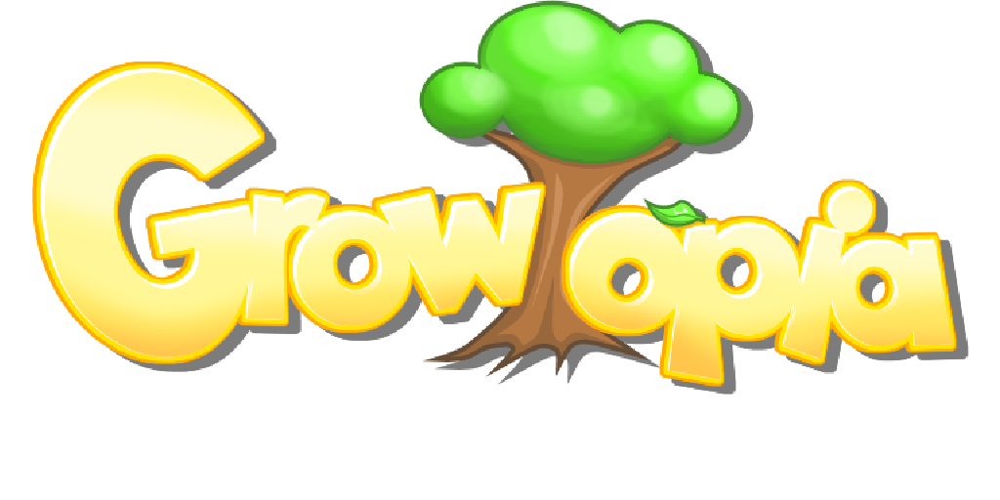

# GrokTopia — Growtopia Sandbox

Authentic 2D MMO sandbox game recreating classic Growtopia physics, graphics, tile splicing, and multiplayer mechanics.



## Features
- **Authentic Growtopia Physics**: Snappy acceleration, coyote time (100ms), jump buffering (120ms), instant turn responsiveness (1.6x), and 5.5px head corner nudge.
- **Official Assets & Audio**: 98 official Akamai CDN textures, tilesets, clothing parts, and `.wav` SFX (`punch.wav`, `jump.wav`, `hit.wav`, `splat.wav`, `click.wav`, `teleport.wav`).
- **Full Punch & Walk Animations**: 5-frame `player_puncharm` extension, body bounce, foot lift clearance, counter-arm swinging, and tool rotation.
- **World & Tile Mechanics**: 100x60 worlds with Bedrock, Dirt, Rock, Lava, Doors, Seeds, and Tree splicing stages.
- **Real-Time Multiplayer**: Built on Socket.IO with sub-tick interpolation, chat bubbles, inventory management, and SQLite persistence.
- **Vercel & Render Ready**: Dedicated `vercel.json` for frontend CDN hosting and `VITE_SERVER_URL` support.

## Controls
- **A / D** or **Arrow Left / Right**: Move
- **W / Space / Arrow Up**: Jump (double jump with Angel / Crimson Wings)
- **S / Arrow Down**: Drop through one-way platforms
- **Left Click / Touch**: Punch, break tiles, or place held item
- **Right Click / Wrench**: Inspect tile or use door
- **Tab / Backpack Handle**: Toggle inventory

## Development
```bash
# Install dependencies
npm install

# Run dev server & client
npm run dev

# Run test suite
npm test

# Build for production
npm run build
```

## Public Deployment
- **Frontend (Vercel)**: Connect this repository to Vercel. Set `VITE_SERVER_URL` to your backend URL.
- **Backend (Render / Railway / VPS)**: Deploy this repository as a persistent Node service (`npm start`) with Node `>=22.0.0`.
